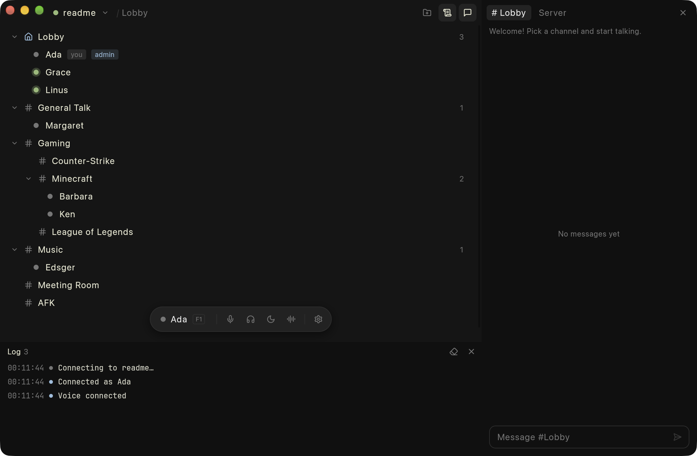

# moqspeak

**Media over QUIC Speak** is a voice chat app in the spirit of TeamSpeak: servers with a channel
tree, push-to-talk or voice activation, text chat, pokes and screen sharing. It is a native Rust
application built on [zgui](https://github.com/zortax/zgui). Voice and video travel over
[Media over QUIC](https://github.com/moq-dev/moq) through Cloudflare's MoQ relay. A small
Cloudflare Worker keeps track of servers, channels and who is where.

<picture>
  <source media="(prefers-color-scheme: light)" srcset="docs/screenshot-light.png">
  
</picture>

## Features

- **Channels the TeamSpeak way.** Double-click a channel to join it. Drag someone onto another
  channel to move them. Right-click anything for its actions.
- **Clear voice.** Opus with forward error correction, echo cancellation (WebRTC AEC3), noise
  suppression (RNNoise) and a speech detector that opens the microphone for your voice alone.
  Choose voice activation, push-to-talk or continuous transmission.
- **Chat.** One conversation for your channel, one for the whole server, and private
  conversations with anyone. The chat column opens when a message arrives.
- **Pokes.** A short message that pops up on someone's screen.
- **Interface sounds.** Short generated tones for mute, deafen, joins, moves, pokes and messages.
- **Per-person controls.** Local volume (0–200 %) and local mute for everyone you hear.
- **Roles.** Users, moderators and admins. The first person on a new server becomes its admin.
- **Saved servers.** Keep the servers you use and switch between them from the server menu.
- **Screen sharing** (opt-in at build time). On macOS, Apple's picker shares a single window, an
  app or a display. On Linux and Windows, a display is shared. Viewers watch in a separate
  window. Video is AV1.
- **TeamSpeak 3 servers** (experimental). Give a `ts3server://` address and moqspeak speaks the
  TeamSpeak 3 protocol instead: talk, move between channels, chat and poke, against a real
  TeamSpeak server. The tree draws TeamSpeak's spacers, so a server keeps the shape it was
  arranged in.
- **Themes.** Jellybeans and 25 other palettes, each with a light and a dark surface, or one that
  follows the system.

## Install

Download the build for your system from
[Releases](https://github.com/Newspicel/moqspeak/releases):

| System | File |
|---|---|
| macOS 14 or later (Apple silicon) | `moqspeak-macos-arm64.dmg` |
| Windows (x86-64) | `moqspeak-windows-x86_64.zip` |
| Linux (x86-64) | `moqspeak-linux-x86_64.tar.gz` |

On first start, macOS asks for microphone access.

The release builds leave out screen sharing. To use it, [build from source](#building-from-source)
with the `screen-share` feature.

## Using moqspeak

Enter a server address and a nickname on the start page, for example
`moq.newspicel.dev/public`. The part after the slash is the server's name. Any name works: a new
name creates a new server with a default set of channels.

To reach a TeamSpeak 3 server, write its address with the `ts3server://` or `ts3://` scheme, such
as `ts3server://voice.example.com`. A `port`, `password`, `channel` or `channelpassword` in the
link is read as well. The scheme alone decides which protocol moqspeak speaks, so saved servers
of both kinds sit side by side.

| To | Do |
|---|---|
| Join a channel | Double-click it, or select it and press Enter |
| Fold a channel | Click its arrow, or press ← and → |
| Talk with push-to-talk | Hold F1, hold `` ` `` while you are not typing, or hold the talk key in the pill |
| Mute, turn sound off, set away | The keys in the pill at the foot of the channel tree |
| Hear yourself, disconnect | Your name at the start of the pill |
| Message someone | Double-click them |
| Poke, change volume, mute for yourself | Right-click them |
| Move someone (moderators) | Drag them onto a channel, or right-click and *Move to my channel* |
| Create a channel (moderators) | The folder key at the top, or right-click a channel for a sub-channel |
| Show the chat or the log | The keys at the top right of the channel tree |
| Switch servers, save one, copy the address | The server name at the top left |
| Share your screen | The screen key in the pill (`screen-share` builds) |
| Change devices, voice mode, sounds, theme | The settings key in the pill |

**Roles.** Moderators can create channels, move people and kick them from a channel. Admins can
also delete channels and give or take roles. Each installation has its own Ed25519 identity, so a
role stays with the person who has it. The identity is the file `identity.key` beside
`settings.json` in the configuration directory:

| System | Directory |
|---|---|
| macOS | `~/Library/Application Support/dev.moqspeak.moqspeak/` |
| Linux | `~/.config/moqspeak/` |
| Windows | `%APPDATA%\moqspeak\moqspeak\config\` |

## How it works

```
            ┌────────────── WebSocket (JSON) ───────────────┐
 moqspeak ──┤                                               ├──► Cloudflare Worker
  client    │                                               │    one Durable Object per server:
            │                                               │    channels, people, chat, roles
            └──── Media over QUIC (IETF draft-16) ──────────┴──► Cloudflare MoQ relay
                  one broadcast per person:
                  "audio"  – Opus, 20 ms frames
                  "screen" – AV1, a new group at every keyframe
```

The **Worker** is the control plane. A client connects, proves its identity by signing a
challenge, and receives the channel tree, the list of people and a token for the relay. Every
change (a join, a move, a chat message) goes through the Worker, and the Worker sends the new
state to everyone on that server.

The **relay** carries the media. Each client publishes one broadcast with an `audio` track and a
`screen` track, and subscribes to the audio of everyone in its channel. A client fetches a screen
only while someone watches it. A screen starts a new group at each keyframe, so a viewer who joins
late sees a picture within about two seconds.

Audio stays inside the client until it is encoded. The microphone signal passes through echo
cancellation, noise suppression and speech detection before Opus encodes it. Incoming voices go
through a short jitter buffer and are mixed for the speakers.

## Building from source

You need [rustup](https://rustup.rs), plus `cmake` and `nasm`. rustup installs the pinned nightly
toolchain from `rust-toolchain.toml` on first use. Opus and the AV1 encoder's assembly are built
from source.

- **Linux** also needs the development packages that `.github/workflows/build.yml` installs
  (ALSA, X11 and Wayland, PipeWire, fontconfig, D-Bus, clang).
- **macOS** needs Xcode 16 or later (the macOS 15 SDK). The app runs on macOS 14 and later.

```sh
cargo run -p moqspeak --release                                   # start the app
cargo run -p moqspeak --release -- moq.newspicel.dev/demo Ada     # connect at start
cargo run -p moqspeak --release --features screen-share           # with screen sharing
```

The `screen-share` feature builds in the capture, the AV1 codec, the share key and the
*Watch screen* item. Without it, none of these exist.

`RUST_LOG` sets the log level, for example `RUST_LOG=moqspeak=debug`.

To build and install the macOS app bundle:

```sh
cargo build -p moqspeak --release
packaging/macos/bundle.sh          # writes dist/moqspeak.app
cp -R dist/moqspeak.app /Applications/
```

### Testing with bots

A bot is a headless participant. It joins a server, moves to a channel, beeps every two seconds
and prints whom it hears. Start a few beside the client to see a populated server:

```sh
cargo run -p moqspeak --release -- --bot moq.newspicel.dev/demo Grace Lobby
cargo run -p moqspeak --release -- --bot moq.newspicel.dev/demo Linus "General Talk" --wander
cargo run -p moqspeak --release --features screen-share -- --bot moq.newspicel.dev/demo Ken Gaming --share-pattern
```

`--wander` joins the next channel every few seconds. `--share-pattern` shares a moving test
pattern and needs the `screen-share` feature.

### Checks

```sh
cargo fmt --check
cargo clippy -p moqspeak
cargo test -p moqspeak --locked
cd server && pnpm check
```

## Hosting your own server

The server is the Cloudflare Worker in `server/`. In `server/wrangler.jsonc`, set:

- `routes` to your own domain,
- `MOQ_RELAY`, `MOQ_RELAY_ID` and `CF_ACCOUNT_ID` to your MoQ relay and account.

Then deploy it with [Wrangler](https://developers.cloudflare.com/workers/wrangler/):

```sh
cd server
pnpm install
wrangler deploy
```

Clients connect with `<your-domain>/<server-name>`. For local development, `wrangler dev` serves
the Worker on `localhost:8787`, and the client connects to `localhost:8787/<server-name>`.

Clients need a token for the relay. There are two ways to give them one:

- **Rotating tokens (recommended).** Store a Cloudflare API token that can manage MoQ relay
  tokens with `wrangler secret put CF_API_TOKEN`. The Worker then creates a token valid for
  24 hours, replaces it when less than six hours remain, and deletes expired ones. If rotation
  fails, it falls back to `MOQ_TOKEN` and logs why.
- **A fixed token.** Create one with
  `cf realtime moq relays tokens create <relay-id> --operations publish subscribe` and store it with
  `wrangler secret put MOQ_TOKEN`.

A relay accepts at most ten tokens, so all clients share the current token.

## Releases

Every push to `main` and every pull request builds and tests on Linux, macOS and Windows. Pushing
a tag such as `v0.2.0` also publishes a GitHub release with the downloads above.

macOS builds are signed with your Developer ID and notarized when these repository secrets exist.
Without them, the app is signed ad hoc, and Gatekeeper asks the user to approve it on first launch.

| Secret | Contents |
|---|---|
| `MACOS_CERTIFICATE` | The *Developer ID Application* certificate with its private key, exported as `.p12` and base64-encoded (`base64 -i cert.p12 \| pbcopy`) |
| `MACOS_CERTIFICATE_PASSWORD` | The password of that `.p12` file |
| `APPLE_API_KEY` | An App Store Connect API key (`AuthKey_….p8`, role *Developer*), base64-encoded |
| `APPLE_API_KEY_ID` | The ID of that key |
| `APPLE_API_ISSUER_ID` | The issuer ID shown on the App Store Connect API keys page |

## Project layout

| Path | Contents |
|---|---|
| `client/src/ui/` | The interface, by feature: `tree`, `pill`, `head`, `chat`, `log`, `settings`, `home`, `dialogs`, `screen`, `theme` and the shared `state` |
| `client/assets/` | The style sheets (`css/`), the themes (`themes/`) and the Lucide icons (`icons/`) |
| `client/src/audio/` | Devices, Opus, mixing, voice processing and the interface sounds (`cue/`) |
| `client/src/screen/` | Screen capture, AV1 encoding and decoding |
| `client/src/transport/` | The transports: `moq/` for the Worker and the MoQ relay, `ts3/` for TeamSpeak 3 |
| `client/src/engine.rs` | The network thread: reconnects, and the transport an address names |
| `client/src/identity.rs` | The Ed25519 identity |
| `client/src/bot.rs` | The headless test participant |
| `ts3proto/` | The TeamSpeak 3 client protocol: handshake, transport, commands and voice |
| `server/src/index.ts` | The Worker: servers, channels, roles and relay tokens |
| `packaging/` | Icons, the macOS bundle script and the Linux desktop file |

## Known limitations

- Anyone who knows a server's address can join it. Roles limit what people can do there. Server
  passwords do not exist yet.
- Screen sharing adds roughly a third of a second of delay, from the AV1 encoder.
- macOS builds are Apple silicon only.
- TeamSpeak 3 support is experimental. It carries voice, channel moves, chat and pokes. It shares
  no screens, leaves channel editing to the TeamSpeak client, and shows everyone as a plain user,
  because TeamSpeak grants server groups in place of moqspeak's three roles. moqspeak appears on
  a TeamSpeak server as a Windows client: a server accepts only a version string TeamSpeak has
  signed, and that signature covers the platform with it.

## License

ISC, see [`LICENSE`](LICENSE). Icons are from [Lucide](https://lucide.dev), also ISC.
